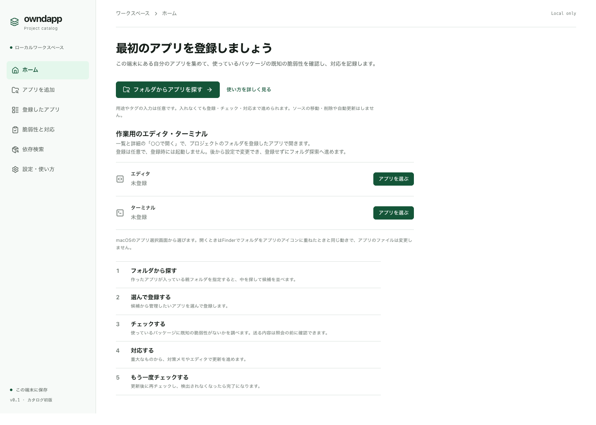

# はじめる

## 必要なもの

- Mac（Windowsは試験的な対応です）
- Node.js 24.14 以降

## インストールして起動する

1. owndapp を取得します。

   ```sh
   git clone https://github.com/elephantnode/owndapp.git
   cd owndapp
   ```

2. 次のコマンドを1行ずつ実行します。エラーが出たら、次へ進まずに[困ったとき](05-troubleshooting.md)を見てください。

   ```sh
   npm run doctor
   npm audit --package-lock-only --audit-level=high
   npm ci --ignore-scripts --include=dev
   npm audit signatures
   npm run build
   npm start
   ```

   - 最初の `npm run doctor` は「依存がない」「ビルドがない」の2件を指摘して終わります。この2件はあとのコマンドで解消するので、そのまま進めてかまいません。
   - 2行目と4行目は、owndapp が使うパッケージの安全確認です。重大な指摘や失敗が出たら、先へ進まずに内容を確認してください。

3. ブラウザで **http://127.0.0.1:4310** を開きます。



## 次から

- 起動：owndapp のフォルダで `npm start`
- 停止：起動したターミナルで `Ctrl` + `C`

データはこの Mac の中（owndapp のフォルダの `.owndapp`）にだけ保存されます。

次は[アプリを登録する](02-register.md)へ。
