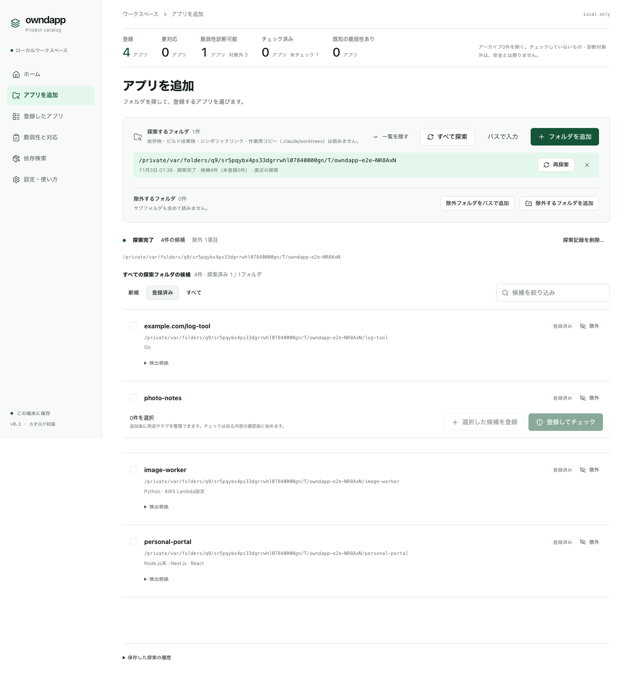
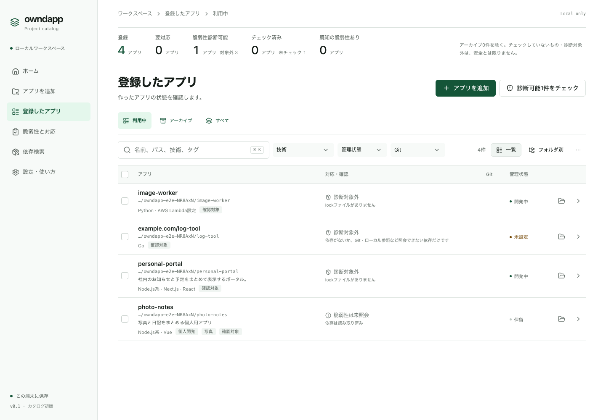

# アプリを登録する

## フォルダから探す

1. メニューの「アプリを追加」を開きます。
2. 「フォルダを追加」を押し、作ったアプリが入っている親フォルダ（例：`~/Projects`）を選びます。
3. 探索が終わると、見つかったアプリが一覧に並びます。
4. 登録したいアプリにチェックを入れ、「登録してチェック」を押します（チェックをあとにする場合は「選択した候補を登録」）。

- フォルダの中身を読むのはこの Mac の中だけで、外部には送りません。
- ソースのファイルを移動・変更・削除することはありません。
- 探したくないフォルダは「除外するフォルダを追加」で外せます。

## 登録したアプリを見る

メニューの「登録したアプリ」に一覧が出ます。名前・技術・管理状態で絞り込めます。

- アプリを押すと詳細が開き、用途・タグ・メモを書けます。入力は任意です。
- 使わなくなったアプリは、詳細の「アーカイブする」で一覧から外せます。記録は残り、いつでも戻せます。

## 「診断対象外」と出るアプリ

lock ファイルがない、または owndapp が読めない形式（Swift など）のアプリは、脆弱性をチェックできないため「診断対象外」と表示されます。管理の対象としては登録したままでかまいません。

次は[脆弱性をチェックして対応する](03-check-and-fix.md)へ。
