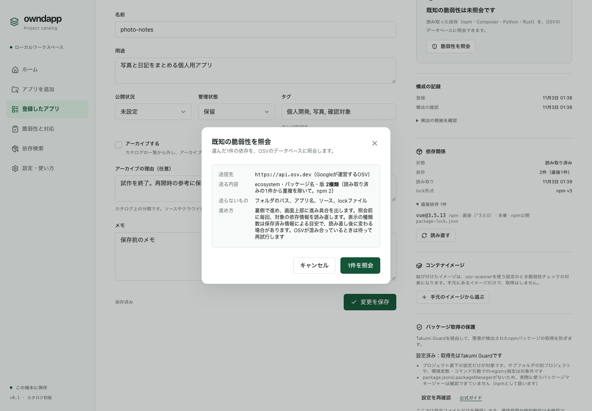
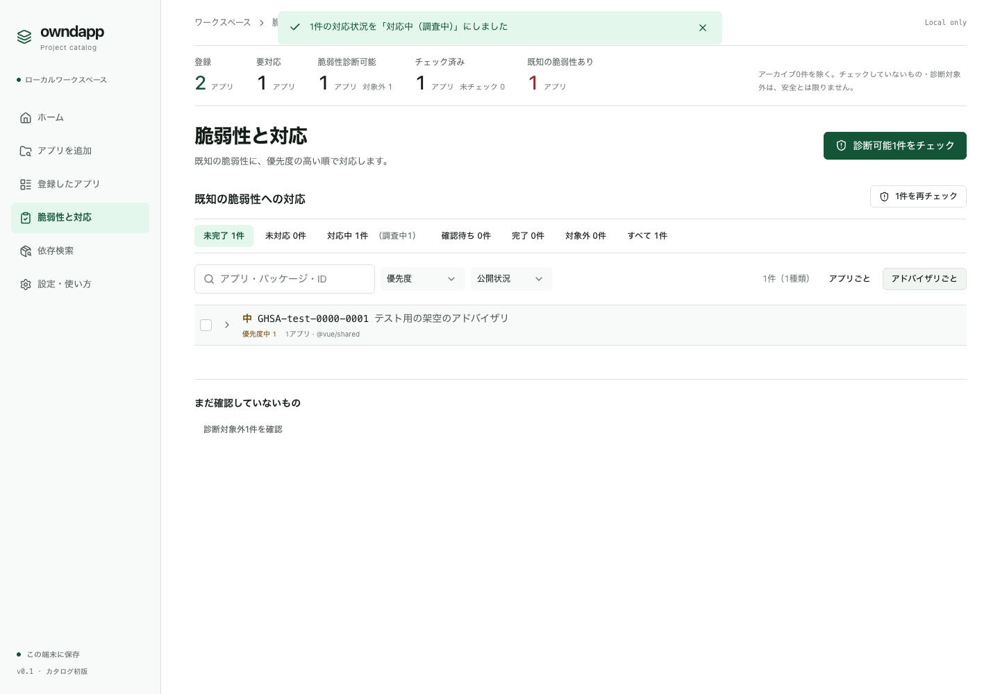

# 脆弱性をチェックして対応する

## チェックする

1. 「登録したアプリ」か「脆弱性と対応」で、「診断可能N件をチェック」を押します。
2. 送る内容の確認画面が出ます。送り先と件数を確かめて「照会」を押します。

- 送るのは、パッケージの種類・名前・版だけです。フォルダのパスやソースは送りません。
- 送り先は、Google が運営する脆弱性データベース OSV（api.osv.dev）です。

## 重大なものから対応する

メニューの「脆弱性と対応」に、見つかった脆弱性が優先度の高い順に並びます。

1. 一番上のものから開き、修正版（更新先の版）を確認します。
2. 「対策メモ」をコピーすると、更新の手順をまとめたメモが手に入ります。Claude Code などに渡して作業できます。
3. 作業を始めたら、対応状況を「対応中」にしておくと、どこまで進んだかがわかります。
4. パッケージを更新したら、もう一度チェックします。検出されなくなったものが自動で「完了」になります。手で完了にはできません。

- owndapp がパッケージを自動で更新することはありません。
- `npm audit fix --force` のような一括修正は、アプリが壊れることがあるので勧めていません。

## 表示の意味

| 表示 | 意味 |
| --- | --- |
| 優先度 高 | 緊急・高の脆弱性。先に対応します |
| 要確認 | 重大度がわからない脆弱性。内容を見て判断します |
| 結果が古い | チェックのあとに依存が変わりました。もう一度チェックします |
| 診断対象外 | チェックできる依存がありません。安全という意味ではありません |

## もっと調べたいとき（任意）

- 特定のパッケージを使っているアプリは、メニューの「依存検索」で探せます（[アプリを整理する・探す](04-organize.md#パッケージを使っているアプリを探す)）。
- osv-scanner を入れている場合は、「設定・使い方」で「osv-scannerを使う」を選ぶと、Swift・Dart・.NET などの lock と Docker イメージもチェックできます。
