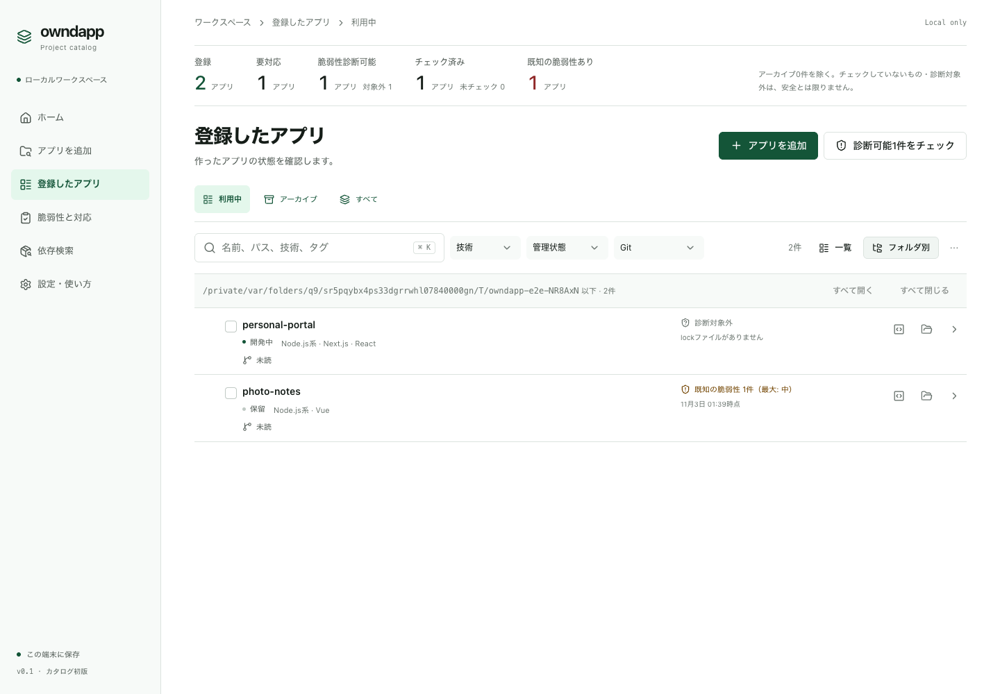

# アプリを整理する・探す

## 一覧を見やすくする

- 「登録したアプリ」の上の「利用中・アーカイブ・すべて」で、表示するアプリを切り替えます。
- 「一覧」と「フォルダ別」を切り替えられます。フォルダ別では保存場所の階層で表示し、フォルダのチェックで中のアプリをまとめて選べます。
- 検索欄では、名前・パス・技術・タグ・用途・メモで探せます。

## まとめて変更する

一覧でアプリにチェックを入れると、上に操作が並びます。タグの追加、管理状態の変更、依存情報の読み取り、脆弱性のチェックなどを、まとめて行えます（1回1000件まで）。

## エディタ・ターミナルで開く

「設定・使い方」でエディタとターミナルを1つずつ登録すると、一覧と詳細の「○○で開く」でアプリのフォルダを開けます。Mac では「Finderで表示」も使えます。

## 使わなくなったアプリを片付ける

| したいこと | 使う機能 | 記録 |
| --- | --- | --- |
| 一覧から外したいが、記録は残したい | 詳細の「アーカイブする」 | 残る。いつでも戻せる |
| フォルダを消した・移したアプリを外したい | 一覧の上に出る「カタログから外す…」 | 用途・メモ・履歴は残る |
| そのフォルダを今後探さない | 「除外するフォルダを追加」 | 登録済みのアプリはそのまま |

どれを使っても、ソースのフォルダやファイルは移動・削除しません。

## パッケージを使っているアプリを探す

メニューの「依存検索」で、パッケージ名の一部を入れて検索します（例：`brotli`）。版まで絞るときは `next@15.1.0` のように書きます。

- 探せるのは、owndapp が依存を読み取ったアプリだけです。読み取っていないアプリは「依存の検索範囲」から読み取れます。
- コードの中で直接使っている標準機能などは検索できません。

## 進み具合の表示

探索・依存の読み取り・チェックの進み具合は、画面の上の真ん中に表示されます。ほかの画面に移っても続きます。
